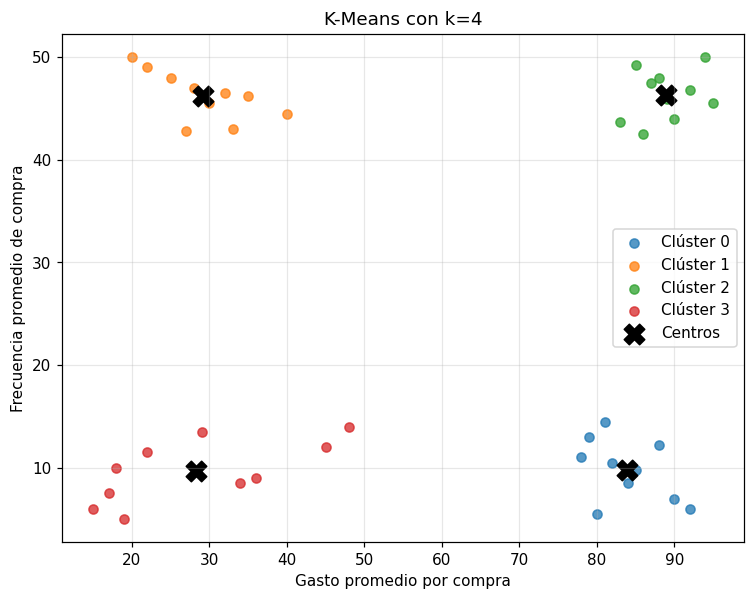

# Mini portafolio · 3 modelos de machine learning

Un modelo por cada tipo de problema del curso, entrenado sobre los datasets del ejercicio *Explore Machine Learning*. Cada cuaderno sigue el mismo proceso: preparación de datos, línea base, varios candidatos comparados con validación cruzada, confirmación en un conjunto de prueba reservado y predicción de los casos de prueba del ejercicio.

| # | Tipo | Problema | Dataset | Modelo elegido | Métrica principal | Cuaderno |
|---|---|---|---|---|---|---|
| 1 | Regresión | Ventas diarias de helados | `ice-cream.csv` (200 días) | Regresión lineal | RMSE **5.65** · R² **0.989** | [`01-regresion-helados.ipynb`](../notebooks/01-regresion-helados.ipynb) |
| 2 | Clasificación multiclase | Especie de pingüino | `penguins.csv` (342 válidos) | Regresión logística | F1 macro **1.000** (prueba) · 0.984 (CV) | [`02-clasificacion-pinguinos.ipynb`](../notebooks/02-clasificacion-pinguinos.ipynb) |
| 3 | Clustering | Segmentos de clientes | `customers.csv` (40 clientes) | K-Means, k=4 | Silueta **0.810** | [`03-clustering-clientes.ipynb`](../notebooks/03-clustering-clientes.ipynb) |

---

## 1. Regresión · ventas de helados

**Features:** día de la semana y mes (one-hot), temperatura y lluvia. `Date` se descarta: es única cada día.
**Etiqueta:** `IceCreamsSold`.
**División:** 70/30 (140 / 60 días).

La regresión lineal queda pegada a la diagonal; la línea base (predecir siempre la media) es una franja horizontal que no explica nada.

**Lectura del modelo:** cada grado de temperatura suma ~5.1 helados y cada pulgada de lluvia resta ~8.4.

| Caso del ejercicio | Día | Mes | Temp. | Lluvia | Predicción |
|---|---|---|---|---|---|
| 1 | Friday | May | 72.3 | 0.01 | **130** helados |
| 2 | Monday | November | 55.8 | 0.56 | **41** helados |

---

## 2. Clasificación multiclase · especie de pingüino

**Features:** largo y profundidad del pico, largo de la aleta, masa corporal.
**Etiqueta:** `Species` (0 Adelie · 1 Gentoo · 2 Barbijo).
**Preparación:** 2 filas con las 4 medidas vacías descartadas; división 70/30 **estratificada**; escalado dentro del pipeline para los modelos sensibles a magnitudes.

A la izquierda, el modelo elegido: diagonal perfecta. A la derecha, el mismo problema con **solo la longitud de aleta** (el ejemplo simplificado del módulo 6): Barbijo se confunde masivamente con Adelie.

| Caso del ejercicio | Pico largo | Pico prof. | Aleta | Masa | Predicción |
|---|---|---|---|---|---|
| 1 | 45.2 | 15.4 | 219 | 4753 | **1 · Gentoo** |
| 2 | 46.9 | 16.7 | 189 | 3645 | **2 · Barbijo** |

---

## 3. Clustering · segmentos de clientes

**Features:** gasto medio por compra y frecuencia de compra, escaladas (ambos algoritmos agrupan por distancia).
**Sin etiqueta.** El número de clústeres se elige con silueta y método del codo, probando k = 2…7.

| Clúster | Gasto medio | Frecuencia | Perfil |
|---|---|---|---|
| 2 | 88.9 | 46.3 | Alto valor |
| 1 | 29.2 | 46.2 | Comprador frecuente pequeño |
| 0 | 83.9 | 9.8 | Compra grande esporádica |
| 3 | 28.3 | 9.7 | Bajo compromiso |

| Caso del ejercicio | Gasto | Frecuencia | Clúster | Distancia a su centro |
|---|---|---|---|---|
| 1 | 21.0 | 105.0 | 1 | **3.20** ⚠️ |
| 2 | 46.9 | 2.0 | 3 | 0.75 |

⚠️ El caso 1 tiene una frecuencia que dobla el máximo de los datos (50). K-Means le asigna un clúster de todos modos, pero queda a más de 4 veces la distancia del cliente real más alejado de cualquier centro (0.703). Es un caso atípico, no un miembro típico del clúster 1.

---

Comparación detallada de los candidatos: [`02-informe-comparacion-modelos.md`](02-informe-comparacion-modelos.md)
