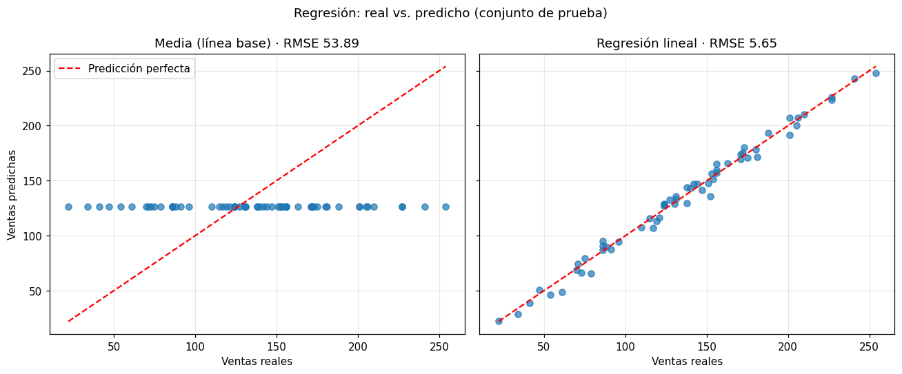
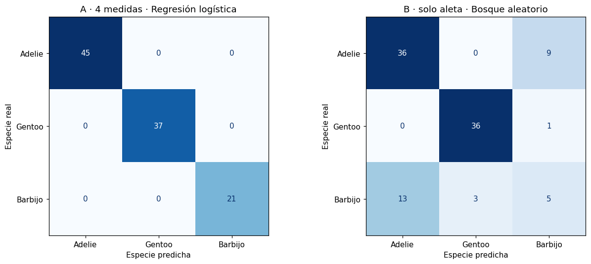
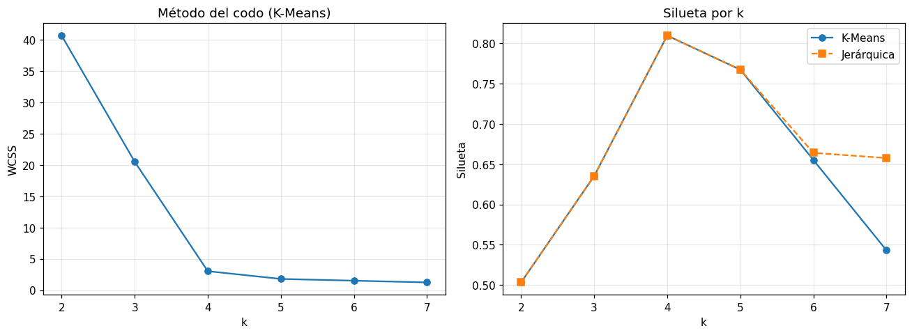

# Informe de comparación de desempeño entre modelos

Para cada tipo de problema del portafolio se compararon varios algoritmos frente a una **línea base**, con el mismo protocolo:

1. División entrenamiento / prueba 70/30 con semilla fija (`random_state=42`); estratificada en clasificación.
2. **Validación cruzada de 5 pliegues** solo sobre el entrenamiento → media y desviación de cada métrica.
3. Entrenamiento con todo el conjunto de entrenamiento y **una única evaluación** sobre la prueba.
4. Todo el preprocesamiento dentro de un `Pipeline`, para que nunca vea datos de validación al ajustarse.

> **Los modelos de tipos distintos no se comparan entre sí.** Un RMSE de 5.65 helados, un F1 de 1.0 y una silueta de 0.81 miden cosas diferentes en escalas diferentes. La comparación tiene sentido **dentro** de cada tipo; entre tipos, lo comparable es el proceso.

---

## 1. Regresión · ventas de helados

**Validación cruzada (entrenamiento, 140 días)**

| Modelo | MAE | RMSE | R² | R² desv. |
|---|---|---|---|---|
| **Regresión lineal** | **3.996** | **5.024** | **0.992** | 0.002 |
| Gradient boosting | 5.252 | 6.521 | 0.987 | 0.003 |
| Bosque aleatorio | 5.690 | 6.806 | 0.986 | 0.003 |
| Árbol de decisión | 7.414 | 9.081 | 0.975 | 0.008 |
| Media (línea base) | 50.553 | 59.835 | −0.039 | 0.045 |

**Prueba (60 días)**

| Modelo | MAE | MSE | RMSE | R² |
|---|---|---|---|---|
| **Regresión lineal** | **4.590** | **31.923** | **5.650** | **0.989** |
| Bosque aleatorio | 4.939 | 45.408 | 6.739 | 0.984 |
| Gradient boosting | 5.235 | 47.340 | 6.880 | 0.983 |
| Árbol de decisión | 5.800 | 64.433 | 8.027 | 0.977 |
| Media (línea base) | 43.540 | 2903.870 | 53.888 | −0.026 |

**Conclusión:** gana la **regresión lineal** en ambas evaluaciones. Los modelos de árboles, más flexibles, no encuentran nada que la recta no capture: la relación clima → ventas es esencialmente lineal. El bosque aleatorio y el gradient boosting intercambian posiciones entre CV y prueba porque sus diferencias son pequeñas; un único reparto no habría bastado para ordenarlos.

---

## 2. Clasificación multiclase · especie de pingüino

Métrica principal: **F1 macro**, que promedia el F1 de cada especie sin ponderar por tamaño. Las especies no están equilibradas (Adelie 44%, Gentoo 36%, Barbijo 20%) y la exactitud sola podría esconder una especie mal clasificada.

### Escenario A · las 4 medidas

| Modelo | Exactitud (CV) | F1 macro (CV) | F1 desv. | Exactitud (prueba) | F1 macro (prueba) |
|---|---|---|---|---|---|
| **Regresión logística** | **0.988** | **0.984** | 0.013 | **1.000** | **1.000** |
| SVM | 0.988 | 0.984 | 0.013 | 0.981 | 0.977 |
| Bosque aleatorio | 0.971 | 0.965 | 0.027 | 0.981 | 0.977 |
| Árbol de decisión | 0.941 | 0.930 | 0.032 | 0.981 | 0.977 |
| Clase más frecuente (línea base) | 0.444 | 0.205 | 0.003 | 0.437 | 0.203 |

**Conclusión:** empate en CV entre regresión logística y SVM; la regresión logística acierta todo en prueba y es más simple → **elegida**. El árbol solo es el más débil en CV, y el bosque aleatorio lo mejora, como se espera de un conjunto.

### Escenario B · solo la longitud de aleta

El dataset completo es tan separable que casi no diferencia algoritmos. Con una sola feature, como en el ejemplo del módulo 6, sí:

| Modelo | Exactitud (CV) | F1 macro (CV) | F1 desv. | Exactitud (prueba) | F1 macro (prueba) |
|---|---|---|---|---|---|
| Bosque aleatorio | 0.778 | **0.679** | 0.031 | 0.748 | **0.664** |
| Árbol de decisión | 0.787 | 0.665 | 0.050 | 0.777 | 0.655 |
| Regresión logística | **0.812** | 0.652 | 0.070 | **0.786** | 0.643 |
| SVM | 0.795 | 0.620 | 0.040 | 0.786 | 0.662 |
| Clase más frecuente (línea base) | 0.444 | 0.205 | 0.003 | 0.437 | 0.203 |

Informe por clase del bosque aleatorio (prueba):

| Especie | Precisión | Recall | F1 |
|---|---|---|---|
| Adelie | 0.735 | 0.800 | 0.766 |
| Gentoo | 0.923 | 0.973 | 0.947 |
| Barbijo | 0.333 | **0.238** | 0.278 |

De los 21 Barbijo de prueba, 13 se predicen como Adelie: con la aleta sola, esas dos especies se solapan.

**Conclusiones del contraste A vs. B:**

- **Las features pesan más que el algoritmo.** Cambiar de algoritmo mueve el F1 macro unas centésimas; añadir las otras 3 medidas lo sube unos 0.3.
- **La exactitud esconde a la clase minoritaria.** En B, la regresión logística tiene la mejor exactitud (0.812 en CV) y el peor F1 macro entre los modelos reales (0.652).
- **No hay ganador claro en B.** El orden cambia entre CV y prueba, y las diferencias son menores que la desviación entre pliegues.

---

## 3. Clustering · segmentos de clientes

Sin etiquetas no hay exactitud ni línea base. Se comparan **K-Means** y **agrupación jerárquica aglomerativa** por **silueta** para cada k, y se usa el **método del codo** como segundo criterio.

| k | WCSS (K-Means) | Silueta K-Means | Silueta jerárquica |
|---|---|---|---|
| 2 | 40.701 | 0.503 | 0.503 |
| 3 | 20.529 | 0.635 | 0.635 |
| **4** | **3.033** | **0.810** | **0.810** |
| 5 | 1.793 | 0.767 | 0.767 |
| 6 | 1.513 | 0.655 | 0.664 |
| 7 | 1.238 | 0.543 | 0.658 |

Con k=4, los dos algoritmos producen **exactamente la misma partición**: la tabla cruzada es una correspondencia perfecta, 10 clientes por grupo.

**Métricas de separación del módulo 7** (K-Means, k=4, espacio escalado):

| Clúster | Clientes | Dist. media al centro | Dist. media a otros centros | Dist. máxima al centro | Silueta |
|---|---|---|---|---|---|
| 0 | 10 | 0.196 | 2.191 | 0.342 | 0.840 |
| 1 | 10 | 0.202 | 2.235 | 0.376 | 0.843 |
| 2 | 10 | 0.160 | 2.283 | 0.264 | 0.874 |
| 3 | 10 | 0.382 | 2.250 | 0.703 | 0.682 |

En promedio, los clientes de cada clúster están entre 6 y 14 veces más cerca de su propio centro que de los demás. El clúster 3 es el menos compacto: el de ratio más bajo (~6).

**Conclusión:** con grupos tan separados el algoritmo deja de importar. Se elige **K-Means** por un motivo práctico: puede asignar clientes nuevos (`predict`), mientras que la agrupación jerárquica de scikit-learn obliga a reagrupar todo.

---

## Lo que muestra la comparación en conjunto

| Observación | Dónde se vio |
|---|---|
| El modelo más simple ganó o empató en los tres casos | Regresión lineal, regresión logística; K-Means igualó a la jerárquica |
| La línea base es imprescindible para saber si un modelo aprende algo | R² ≈ 0 y F1 0.205 de las líneas base frente a 0.99 de los modelos |
| Una sola división entrenamiento / prueba no basta para ordenar modelos parecidos | Cambios de orden entre CV y prueba en regresión y en el escenario B |
| Las features importan más que el algoritmo | Pingüinos: F1 de ~0.66 a ~0.98 al pasar de 1 a 4 medidas |
| La métrica tiene que corresponder al problema | Exactitud vs. F1 macro con clases desequilibradas |
| Un modelo siempre da una respuesta, aunque el caso no se parezca a nada de lo visto | Cliente con frecuencia 105, asignado igualmente a un clúster |
| Al elegir modelo también cuentan criterios no métricos | K-Means elegido por poder predecir casos nuevos |
