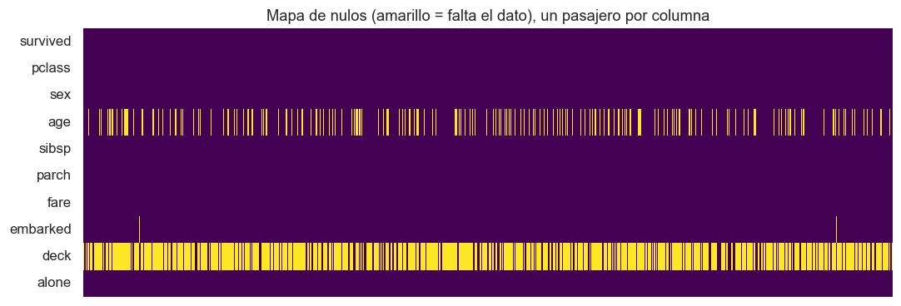
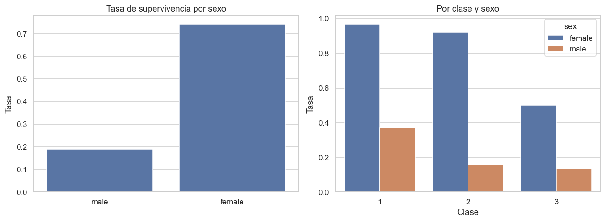
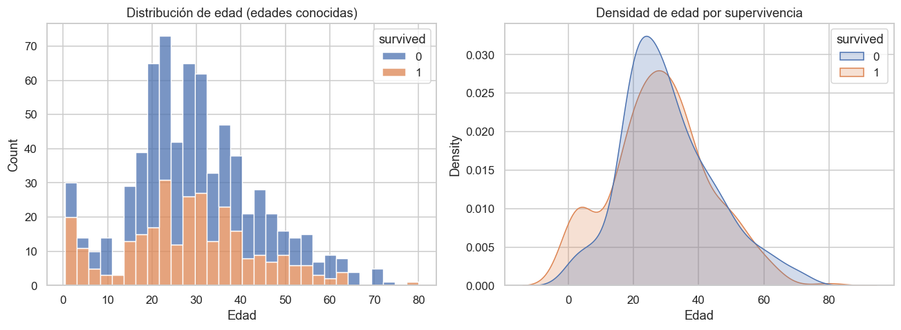
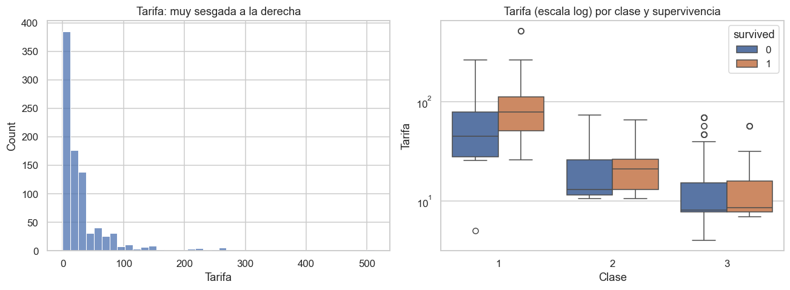
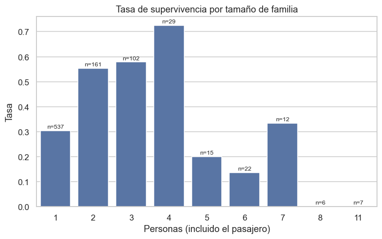
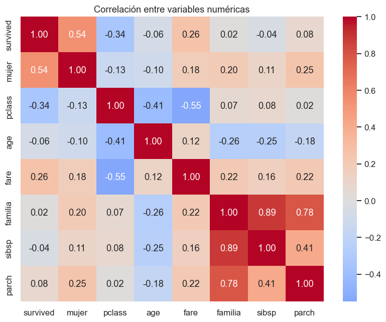

# Proyecto EDA con Pandas, Matplotlib y Seaborn · Titanic

**Cuaderno:** [`notebooks/01-proyecto-eda-titanic.ipynb`](../notebooks/01-proyecto-eda-titanic.ipynb)

Análisis exploratorio de los 891 pasajeros del Titanic para responder qué factores se asocian a la supervivencia. Usa las secciones 5 a 10 del bootcamp (NumPy, Pandas, Matplotlib, Seaborn y visualización con Pandas). El dataset aparece en el curso en los ejercicios de Seaborn y en la clase de regresión logística; se carga con `seaborn.load_dataset`.

| Librería | Para qué se usó |
|---|---|
| **Pandas** | Nulos, imputación por grupo con `groupby().transform()`, `pivot_table`, `pd.cut` para grupos de edad, variables derivadas |
| **Matplotlib** | Figuras con varios paneles (`subplots`), anotaciones, exportar las imágenes |
| **Seaborn** | `heatmap` (nulos y correlaciones), `boxplot`, `barplot`, `histplot`, `kdeplot` |

## 1. Calidad de los datos

| Columna | Nulos | Decisión |
|---|---|---|
| `deck` | 77.2% | Descartada: no hay base para imputar |
| `age` | 19.9% | Mediana de su grupo **clase × sexo**, que va de 21.5 años (mujeres de 3ª) a 40 (hombres de 1ª) |
| `embarked` | 2 filas | Puerto más frecuente |

## 2. Sexo y clase: los dos factores dominantes

| Clase | Mujeres | Hombres |
|---|---|---|
| 1ª | 96.8% | 36.9% |
| 2ª | 92.1% | 15.7% |
| 3ª | 50.0% | 13.5% |

Supervivencia global: 38.4%. Una mujer de 3ª clase tuvo más opciones que un hombre de 1ª.

## 3. Edad: "mujeres y niños primero", hasta los 12 años

Los niños de 0 a 12 años sobrevivieron en torno al 57%, sin diferencia entre sexos. Desde los 13, los varones corrieron la suerte de los adultos: 8.8% de los adolescentes varones frente al 75% de las adolescentes.

## 4. Tarifa

Muy sesgada (mediana 14.45, media 32.20, máximo 512.33), por eso se grafica en escala logarítmica. Su efecto llega sobre todo a través de la clase. Dentro de 1ª, los supervivientes pagaron claramente más; en 3ª apenas hay diferencia.

## 5. Familia: un efecto que la correlación no ve

Viajar solo: 30.4%. Grupos de 2 a 4 personas: del 55% al 72%. Familias de 5 o más: mucho menos. La correlación lineal de `familia` con la supervivencia es casi 0 (0.017) porque la relación sube y luego baja.

## Conclusiones

1. El sexo es el factor más asociado a la supervivencia (correlación 0.54), seguido de la clase (−0.34).
2. La prioridad a los niños se cumplió hasta los 12 años; a partir de ahí, solo para las mujeres.
3. **Una correlación cercana a 0 no significa que no haya relación**: el tamaño de familia lo muestra.
4. Son asociaciones, no causas. Sexo, clase y tarifa están muy ligados entre sí; para separar sus efectos hace falta un modelo.
