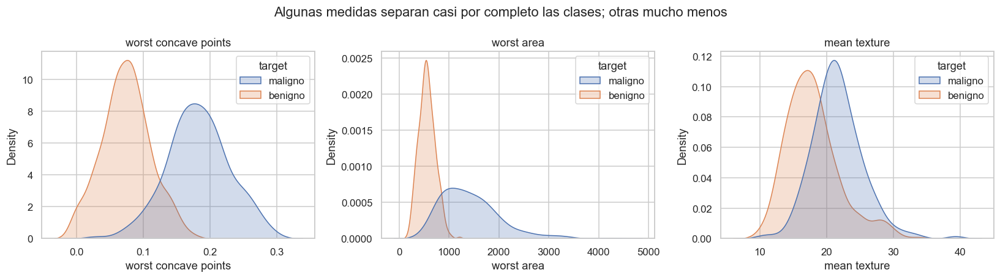
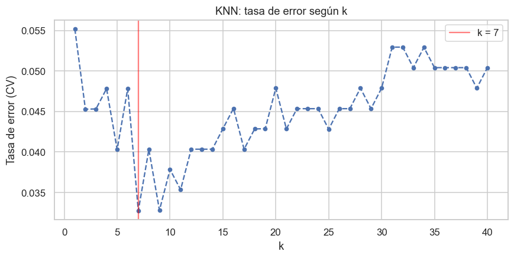
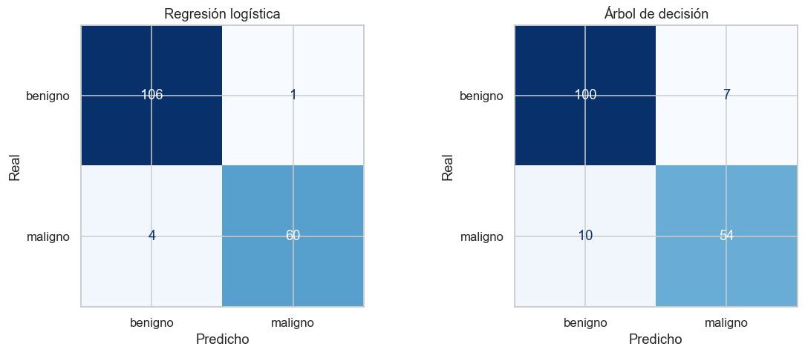
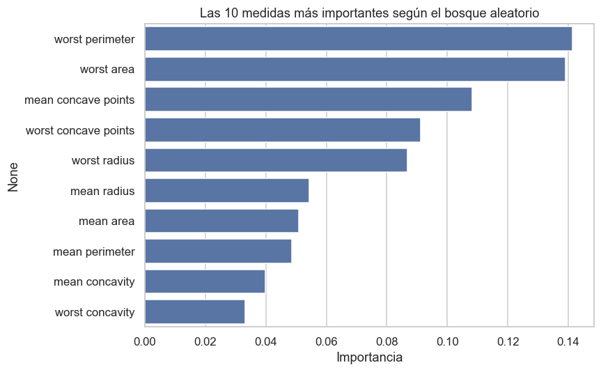

# Proyecto de clasificación con scikit-learn · diagnóstico de tumores de mama

**Cuaderno:** [`notebooks/02-proyecto-clasificacion-cancer-mama.ipynb`](../notebooks/02-proyecto-clasificacion-cancer-mama.ipynb)

Clasificar tumores como **malignos** o **benignos** a partir de 30 medidas celulares (569 casos, 37% malignos). El proyecto compara los cinco clasificadores de la parte de machine learning del bootcamp (secciones 17 a 20). El dataset es *Breast Cancer Wisconsin*, el mismo de la clase de SVM del curso, y viene incluido en scikit-learn.

**Métrica que manda: recall de la clase maligna.** Dejar pasar un tumor maligno es mucho más grave que una falsa alarma.

## Proceso

1. División 70/30 **estratificada** (398 / 171).
2. Escalado (`StandardScaler`) dentro de un `Pipeline` para los modelos basados en distancias o magnitudes (regresión logística, KNN, SVM).
3. **KNN:** elección de `k` por el método del codo de la tasa de error, como en la sección 18, pero con validación cruzada.
4. Comparación con **validación cruzada estratificada de 5 pliegues**.
5. **SVM:** ajuste de `C` y `gamma` con `GridSearchCV`, como en la sección 20.
6. Evaluación final, una sola vez, en el conjunto de prueba.

KNN: error mínimo con **k = 7** (tasa de error 0.033).

## Validación cruzada (entrenamiento)

| Modelo | Exactitud | Recall maligno | Precisión maligno | F1 | AUC | Recall desv. |
|---|---|---|---|---|---|---|
| **Regresión logística** | **0.982** | **0.953** | **1.000** | **0.976** | **0.993** | **0.017** |
| SVM (por defecto) | 0.972 | 0.946 | 0.979 | 0.961 | 0.993 | 0.042 |
| KNN (k=7) | 0.967 | 0.925 | 0.985 | 0.954 | 0.985 | 0.051 |
| Bosque aleatorio | 0.947 | 0.925 | 0.938 | 0.929 | 0.983 | 0.060 |
| Árbol de decisión | 0.920 | 0.891 | 0.898 | 0.892 | 0.914 | 0.055 |
| Clase más frecuente (línea base) | 0.628 | 0.000 | 0.000 | 0.000 | 0.500 | 0.000 |

**Búsqueda en cuadrícula del SVM:** `C=10`, `gamma='scale'`; el recall en CV sube de 0.946 a 0.952.

## Prueba (171 casos, 64 malignos)

| Modelo | Exactitud | Recall maligno | AUC | Malignos no detectados | Falsas alarmas |
|---|---|---|---|---|---|
| Bosque aleatorio | 0.977 | 0.938 | 0.996 | 4 | 0 |
| **Regresión logística** | 0.971 | 0.938 | **0.998** | 4 | 1 |
| SVM (ajustado) | 0.971 | 0.938 | 0.995 | 4 | 1 |
| KNN (k=7) | 0.965 | 0.906 | 0.987 | 6 | 0 |
| SVM (por defecto) | 0.959 | 0.891 | 0.997 | 7 | 0 |
| Árbol de decisión | 0.901 | 0.844 | 0.889 | 10 | 7 |

## Conclusiones

- **Modelo elegido: regresión logística.** Es la mejor en validación cruzada en todas las métricas y la más estable entre pliegues. En la prueba detecta 60 de 64 malignos con 1 sola falsa alarma.
- **Tres modelos empatan en la prueba** (4 malignos no detectados cada uno). Es la razón para elegir con la validación cruzada: con 64 malignos, un solo caso mueve el recall más de 1.5 puntos.
- **Ajustar hiperparámetros sirvió:** el SVM ajustado pasa de 7 a 4 malignos no detectados.
- **Un árbol solo es el peor modelo** (10 malignos no detectados); el bosque aleatorio corrige casi todo eso.
- **Lo que más pesa:** el tamaño del tumor en su peor zona (`worst perimeter`, `worst area`) y la concavidad del contorno.
- **Siguiente paso:** bajar el umbral de decisión para no dejar pasar ese 6% de malignos, a cambio de más falsas alarmas.
