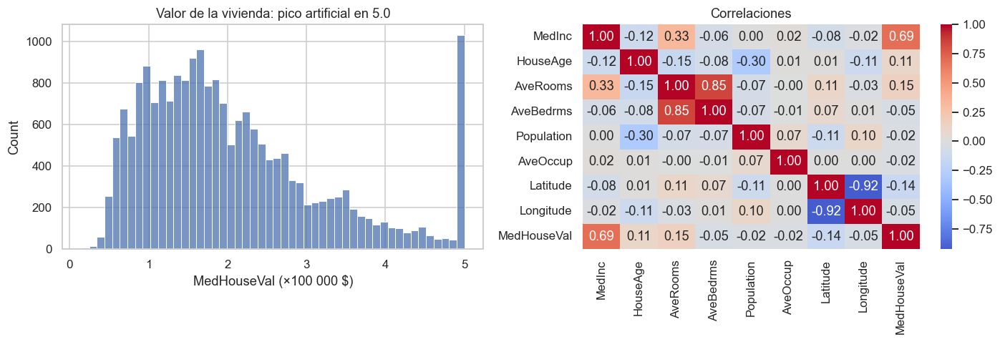
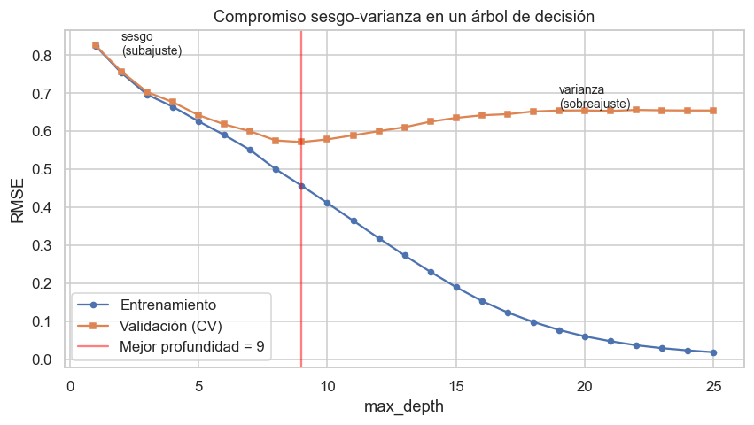
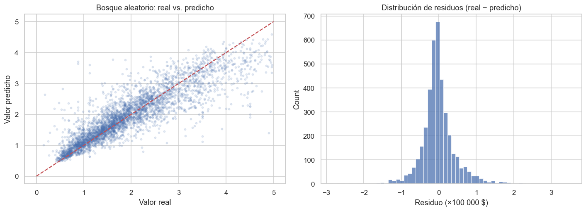

# Proyecto de regresión con validación cruzada · precio de la vivienda en California

**Cuaderno:** [`notebooks/03-proyecto-regresion-vivienda.ipynb`](../notebooks/03-proyecto-regresion-vivienda.ipynb)

Predecir el valor medio de la vivienda de un distrito censal de California (censo de 1990, incluido en scikit-learn) eligiendo el modelo con **validación cruzada**. Cubre las secciones 15 (regresión lineal) y 16 (validación cruzada y compromiso sesgo-varianza) del bootcamp.

## Proceso

1. **Exploración.** 992 distritos (4.8%) tienen el valor topado en 500 000 $: el censo registró ese techo, no el valor real. Se excluyen. El modelo no vale para distritos por encima de ese valor.
2. **Conjunto de prueba reservado desde el principio** (20%: 3 930 distritos).
3. **Regresión lineal** como referencia interpretable.
4. **Validación cruzada de 5 pliegues** para comparar 4 algoritmos y una línea base, midiendo también el error de entrenamiento para detectar sobreajuste.
5. **Curva de validación** de la profundidad de un árbol: el compromiso sesgo-varianza.
6. Evaluación final, una sola vez, en la prueba.

## Validación cruzada (5 pliegues, 15 718 distritos)

| Modelo | RMSE entrenamiento | RMSE validación | RMSE desv. | MAE | R² |
|---|---|---|---|---|---|
| **Bosque aleatorio** | 0.172 | **0.461** | 0.008 | **0.311** | **0.773** |
| KNN (k=10) | 0.519 | 0.577 | 0.015 | 0.408 | 0.646 |
| Regresión lineal | 0.631 | 0.634 | 0.012 | 0.472 | 0.572 |
| Árbol de decisión (sin límite) | **0.000** | 0.657 | 0.008 | 0.437 | 0.540 |
| Media (línea base) | 0.969 | 0.969 | 0.006 | 0.777 | −0.000 |

*Unidades: cientos de miles de dólares.*

El árbol sin límite tiene error **0** en entrenamiento y 0.657 en validación: memorizó los datos.

## Sesgo-varianza

Por debajo de profundidad 9 el árbol no tiene capacidad suficiente: el error es alto en ambos conjuntos (**sesgo**). Por encima, el error de entrenamiento sigue bajando mientras el de validación sube (**varianza**). Limitarlo a profundidad 9 baja su RMSE de validación de 0.655 a **0.571**.

## Prueba (3 930 distritos)

| Modelo | MAE | MSE | RMSE | R² |
|---|---|---|---|---|
| **Bosque aleatorio** | **0.311** | **0.216** | **0.465** | **0.774** |
| Árbol (max_depth=9) | 0.402 | 0.335 | 0.579 | 0.651 |
| Regresión lineal | 0.483 | 0.413 | 0.643 | 0.569 |

## Conclusiones

- **Modelo elegido: bosque aleatorio**, con un error típico de unos **46 500 $** (RMSE 0.465) y R² 0.774.
- **La validación cruzada anticipó el resultado:** estimó un RMSE de 0.461 y la prueba dio 0.465, con el mismo orden de modelos. Eso es lo que la hace útil: estimar cómo se comportará el modelo con datos nuevos sin gastar la prueba.
- **Comparar el error de entrenamiento con el de validación** revela el sobreajuste: total en el árbol sin límite y moderado en el bosque (0.172 frente a 0.461), que aun así es el que mejor generaliza.
- **Regresión lineal:** se queda corta (R² 0.57) pero se puede leer. Cada 10 000 $ más de ingreso mediano suman unos 43 000 $ al valor, y el valor baja hacia el norte y hacia el este.
- **Residuos:** centrados en 0, pero el modelo sobrestima los distritos baratos y subestima los caros.
