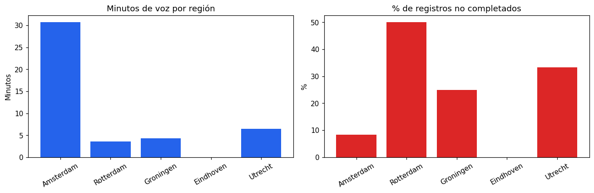

# Entregable 1 · Notebook con ingesta y transformación de datos usando Spark

**Cuaderno:** [`notebooks/01-ingesta-transformacion-spark.ipynb`](../notebooks/01-ingesta-transformacion-spark.ipynb)

Registros de llamadas de una operadora (`telecom_cdrs.csv`, 30 registros de voz, datos y SMS) llevados de archivo crudo a tablas Delta, siguiendo la arquitectura medallion.

## Qué hace

| Paso | Técnica de Spark | Resultado |
|---|---|---|
| Ingesta | `spark.read` con **esquema explícito** (`StructType`) + metadatos de ingesta (`current_timestamp`, `_metadata.file_name`) | `bronce_llamadas` (30 filas) |
| Perfilado | Nulos por columna con una sola agregación; incoherencias entre columnas | 1 nulo legítimo (destinatario de un SMS), 1 llamada con duración negativa |
| Limpieza | `try_to_timestamp`, conversión a booleano, columnas derivadas (`fecha`, `hora`, `duracion_min`, `resultado`), regla de validez | `plata_llamadas` (29 filas; se descarta `CDR010`) |
| Agregación | `groupBy` + `agg` con agregaciones condicionales (`when`) | `oro_llamadas_region` |
| Ventana | `Window.partitionBy('region').orderBy(desc('minutos'))` + `rank()` | `oro_antenas_top`: la antena con más minutos de cada región |
| SQL | `spark.sql()` sobre las tablas Delta (equivale a `%sql` en Databricks) | Perfil por hora |

## Resultados

**Resumen por región** (`oro_llamadas_region`):

| Región | Registros | Llamadas de voz | Minutos de voz | % no completadas | Datos (MB) | Roaming |
|---|---|---|---|---|---|---|
| Amsterdam | 12 | 8 | 30.7 | 8.3 | 1 442.9 | 3 |
| Rotterdam | 6 | 5 | 3.6 | **50.0** | 875.2 | 1 |
| Groningen | 4 | 4 | 4.3 | 25.0 | 0.0 | 0 |
| Eindhoven | 4 | 0 | 0.0 | 0.0 | 881.9 | 0 |
| Utrecht | 3 | 3 | 6.5 | 33.3 | 0.0 | 0 |

**Lectura:** Rotterdam concentra los problemas de red: la mitad de sus registros no se completan (caídas, sin respuesta, ocupado). Eindhoven solo tiene sesiones de datos, sin voz.

## Decisiones técnicas

- **Esquema explícito y fechas como texto.** Las fechas se convierten en plata con `try_to_timestamp`, que devuelve nulo ante un valor inválido en lugar de detener la carga.
- **Bronce intacto.** La llamada con duración negativa se queda en bronce (es lo que llegó) y no pasa a plata.
- **Tablas de oro pequeñas.** Solo las tablas de oro se traen a Pandas (`toPandas()`) para graficar: tienen 5 filas. Con plata o bronce no se haría.
- **Un solo cuaderno para dos entornos.** La primera celda detecta si corre en Databricks (widgets, Unity Catalog, volumen) o en local (Spark 4.0 + Delta Lake en un contenedor). El resto del código es idéntico.
