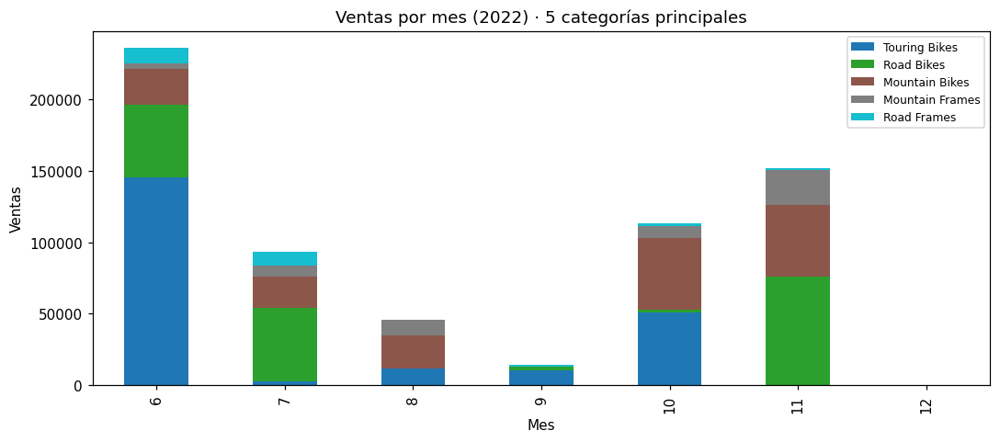

# Entregable 2 · Flujo de transformación con Dataflows Gen2 para preparar datos analíticos

**Código Power Query M:** [`dataflow/`](../dataflow/) · **Réplica ejecutada:** [`notebooks/01-replica-dataflow-pandas.ipynb`](../notebooks/01-replica-dataflow-pandas.ipynb) · **Resultados esperados:** [`datos-esperados/`](../datos-esperados/)

Escenario del curso: una cadena minorista necesita un **modelo de datos coherente** a partir de orígenes dispares (pedidos, clientes, productos). El flujo de datos Gen2 `df_ventas_minoristas` los transforma en un **esquema en estrella** y lo carga en el lakehouse.

## Consultas del flujo

```
UrlBase (parámetro)
   ├── products.csv  ──► dim_producto ─────────────┐
   ├── customers.csv ──► dim_cliente               │ combinar (merge)
   └── orders.csv    ──► fact_ventas ──────────────┼──► ventas_mensuales
                             │ (referencia)        │
                             └──► dim_fecha (generada a partir del rango de fechas)
```

| Consulta | Archivo | Transformaciones de Power Query | Destino |
|---|---|---|---|
| `UrlBase` | [`UrlBase.m`](../dataflow/UrlBase.m) | **Parámetro**: carpeta de origen de los CSV | — (no se carga) |
| `dim_producto` | [`dim_producto.m`](../dataflow/dim_producto.m) | Tipos con cultura `en-US`, recortar espacios, quitar duplicados | Tabla `dim_producto` |
| `dim_cliente` | [`dim_cliente.m`](../dataflow/dim_cliente.m) | Columna combinada (nombre completo), extraer el dominio del correo, **quitar el correo** (dato personal), quitar duplicados | Tabla `dim_cliente` |
| `fact_ventas` | [`fact_ventas.m`](../dataflow/fact_ventas.m) | Tipos, quitar duplicados por clave (pedido + línea), filtrar filas inválidas, columnas personalizadas `MonthNo` (la del laboratorio), `Year`, `UnitPrice` y `DateKey` | Tabla `fact_ventas` |
| `dim_fecha` | [`dim_fecha.m`](../dataflow/dim_fecha.m) | **Generada**: una fila por día de los años con ventas, con año, trimestre, mes, día de la semana y fin de semana | Tabla `dim_fecha` |
| `ventas_mensuales` | [`ventas_mensuales.m`](../dataflow/ventas_mensuales.m) | **Referencia** a `fact_ventas` (no relee el CSV) + **combinar** con `dim_producto` + **agrupar** por año, mes y categoría | Tabla `ventas_mensuales` |

Todas las tablas se cargan con el método **Reemplazar**. El laboratorio usa *Anexar*, que duplica las filas cada vez que el flujo se vuelve a ejecutar sobre el mismo archivo completo. *Anexar* tiene sentido cuando cada ejecución trae solo datos nuevos.

## Resultados esperados

Obtenidos con la réplica en pandas, que aplica paso a paso la misma lógica:

| Tabla | Filas | Control |
|---|---|---|
| `fact_ventas` | 542 | Suma de `LineItemTotal`: **708 690.07** |
| `dim_producto` | 295 | 37 categorías |
| `dim_cliente` | 847 | — |
| `dim_fecha` | 365 | 2022-01-01 → 2022-12-31 |
| `ventas_mensuales` | 122 | Suma de `Ventas`: **708 690.07** (cuadra con `fact_ventas`) |

Integridad comprobada: sin duplicados en la clave de `fact_ventas` y sin productos, clientes ni fechas huérfanos.



Los 542 registros corresponden a 32 pedidos de junio a diciembre de 2022, con 142 productos distintos. Las bicicletas de paseo (*Touring Bikes*) lideran las ventas con el 31%, seguidas de las de carretera (26%) y las de montaña (24%).

## Estado

pendiente [crear y ejecutar el flujo de datos en Fabric]

> **Por qué la cultura `en-US` en los tipos.** Los CSV usan el punto como separador decimal. Con la configuración regional en español, `356.9` podría interpretarse como 3569. Indicar la cultura en `Table.TransformColumnTypes` hace que el resultado no dependa de la región de quien ejecuta el flujo.
